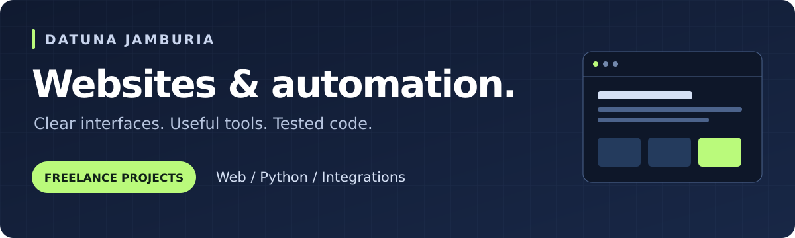

### I build websites and tools that make everyday work easier.

I'm **Datuna**, a developer focused on business websites, Python automation, and JavaScript integrations. I help turn a clear project brief into working software with documented setup and checks.

**[Discuss your project](mailto:jamburiawork@gmail.com)** · [Browse my work](#selected-work) · [Read my writing](articles/README.md) · [Project details](WORK_WITH_ME.md)

## What I can help you build

| Your project | What I can deliver |
| --- | --- |
| **A website for your business** | Responsive landing pages and business sites with clear services, mobile navigation, and contact links. |
| **Less repetitive data work** | Python tools for CSV, Excel, PDF, file processing, validation, and reporting. |
| **Connected tools and workflows** | JavaScript integrations, API connections, and n8n workflows with explicit error handling. |
| **A focused fix to an existing project** | Reproducible bug fixes, regression checks, clearer documentation, and handoff notes. |

## Selected work

### Business website · Design and implementation

**[Explore the website sample →](https://github.com/kalidatuna/small-business-site-sample)**

A four-page HTML/CSS website covering Home, About, Services, and Contact. Includes mobile layouts, keyboard navigation, visible focus states, and reduced-motion support. The repository includes desktop and mobile previews plus recorded browser checks at 360, 768, and 1440 pixels. Alder & Finch is a fictional business used for this portfolio sample.

### Automation and developer tools

| Project | What you can inspect |
| --- | --- |
| **[Offline Toolbox](https://github.com/kalidatuna/offline-toolbox)** | Python utilities and browser tools for file, text, and data tasks. Includes usage instructions, tests, and CI. Most tools run locally without uploads. |
| **[Invoice Validation for n8n](https://github.com/kalidatuna/n8n-invoice-validation-sample)** | A workflow demonstration that checks invoice fields, dates, decimal totals, and duplicates before human review. Includes synthetic inputs, generated workflow files, and 26 documented tests. |
| **[Git Worklog](https://github.com/kalidatuna/git-worklog)** | A Python CLI that turns local Git history into Markdown or JSON work summaries, grouped by UTC day and author. |
| **[CSV Model Check](https://github.com/kalidatuna/csv-model-check)** | A Python validator for two related educational geometry tables. Preserves text IDs and reports malformed rows, missing references, and invalid coordinates as JSON. |

The invoice workflow and geometry checker are independent demonstrations. Each repository explains its scope, setup, and limitations.

## Writing and workflow samples

- **[Articles](articles/README.md)**: technical writing on idempotent webhooks and retry-safe automation.
- **[n8n workflow samples](workflows/n8n/README.md)**: credential-free workflows you can import and run locally.
- **[Architecture examples](examples/README.md)**: synthetic write-ups such as WhatsApp lead routing.

## How we'll work

1. **Define the result.** Share the problem, existing site or files, and what success should look like.
2. **Agree on scope.** Set the deliverables, price, and timeline before implementation.
3. **Build and verify.** Review the working result with checks appropriate to the project.
4. **Hand it over.** Receive the agreed files, setup instructions, and a summary of what changed.

**Core tools:** Python · JavaScript · HTML/CSS · Git · n8n

## Have a project in mind?

Email **[jamburiawork@gmail.com](mailto:jamburiawork@gmail.com)** with your website or project link, the result you need, and your budget and deadline if you have them.

Available for remote freelance projects and agency implementation work.
