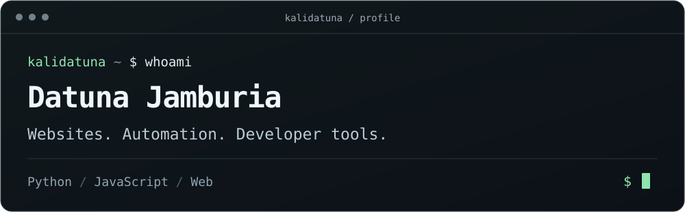

I build business websites, Python tools, and JavaScript integrations. My projects focus on practical problems, with source code, setup instructions, and checks you can inspect.

**[Email](mailto:jamburiawork@gmail.com)** · [Selected projects](#selected-projects) · [All repositories](https://github.com/kalidatuna?tab=repositories)

## Selected projects

### [leadhound](https://github.com/kalidatuna/leadhound): find freelance clients who need you right now

Finds people asking for freelance help today (Freelancer.com, Reddit, Hacker News, GitHub bounties, contract roles) and local businesses with website problems, scores each lead with the reasons listed, and drafts the first message in the client's language. Follow-up reminders, 11 languages, runs on your computer. Free and open source.

`Python` `JavaScript` `SQLite` · zero dependencies · [Website](https://kalidatuna.github.io/leadhound/) · [Try the demo](https://github.com/kalidatuna/leadhound#try-it-in-10-seconds)

### More projects

| Project | What it does | Built with |
| :--- | :--- | :--- |
| **[Business website](https://github.com/kalidatuna/small-business-site-sample)** | Four-page portfolio sample for a fictional business. Responsive layouts, keyboard navigation, and desktop/mobile previews. | `HTML` `CSS` |
| **[Invoice validation](https://github.com/kalidatuna/n8n-invoice-validation-sample)** | Checks invoice fields, dates, totals, and duplicates before human review. Synthetic data and 26 documented tests. | `JavaScript` `n8n` |
| **[dotenv-lint](https://github.com/kalidatuna/dotenv-lint)** | Finds syntax errors, duplicate keys, and missing configuration keys. No runtime dependencies, with JSON output and pre-commit support. | `Python` `CLI` |
| **[Git Worklog](https://github.com/kalidatuna/git-worklog)** | Turns local Git history into Markdown or JSON work summaries, with date and author filters. | `Python` `Git` |

Preview the business website

Alder & Finch is a fictional business. This is an independent portfolio sample.

[View mobile preview](https://github.com/kalidatuna/small-business-site-sample/blob/main/preview-mobile.png) · [Read setup and checks](https://github.com/kalidatuna/small-business-site-sample#readme)

### More tools

**[Offline Toolbox](https://github.com/kalidatuna/offline-toolbox)** brings together local utilities for file handling, CSV inspection, Markdown links, JSON, and text. Python command-line tools and browser utilities, with usage instructions and tests.

## Tools I use

`Python` · `JavaScript` · `HTML / CSS` · `Git` · `n8n`

Source, setup, and verification details live in each project repository.
