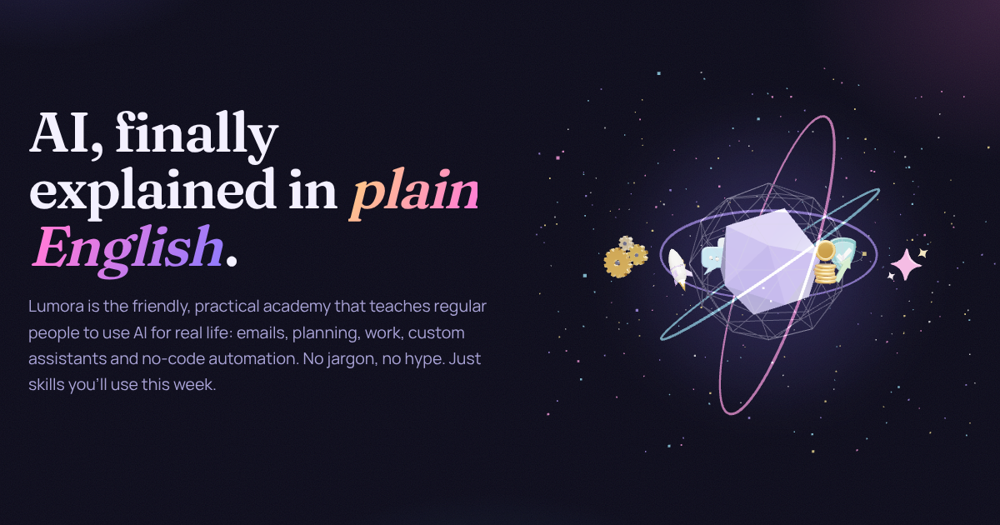

# Lumora · Practical AI for everyday life

Lumora is a complete, sellable online academy that teaches regular people how to use AI: prompting, everyday tasks, work, custom assistants and skills, no-code automation, creativity, small business, safety and power-user tools.

It ships as **one fast Rust binary** that serves the JSON API, Stripe webhooks and a custom 3D-themed web app, with all course content loaded into memory at startup.



## What's inside

| Area | What customers get |
| --- | --- |
| **Curriculum** | 10 modules, 40 lessons (~6 hours), each with a "try it now" prompt, callouts and key takeaways |
| **Quizzes** | 50 questions (5 per module), graded server-side with explanations; 70% pass mark |
| **Certificate** | Printable SVG certificate once every lesson is complete |
| **Prompt library** | 67 copy-paste prompts in 13 categories, with search, filters and bookmarks |
| **Automation playbooks** | 10 step-by-step no-code builds (Zapier / Make / n8n / scheduled AI tasks) |
| **Prompt Builder** | Interactive BRIEF-method builder that scores your prompt and opens it in ChatGPT or Claude |
| **Free resources** | 54-term glossary, 30-tool Tool Finder, AI Starter Kit (lead magnet) |
| **Member area** | Dashboard with progress ring, streaks, quiz scores, saved items and "continue learning" |
| **Account** | Profile, password change and email-based password reset (both sign out other devices), JSON data export, account deletion |
| **Email** | Welcome, password reset, purchase confirmation, payment failed, plan ended, Starter Kit delivery and contact receipts, via Resend or Postmark (or logged to an outbox until you connect one) |
| **Support & trust** | Contact form (stored, emailed to your support inbox, viewable in admin), refund policy, terms, privacy, and publicly verifiable certificates (`/verify/LUM-XXXX-XXXX`) |
| **Billing** | Free tier, Pro Monthly ($14), Pro Yearly ($99), Lifetime ($249) via Stripe Checkout + Customer Portal |
| **Admin** | MRR, revenue, conversion, signups chart, top lessons, member search, contact inbox, sent-email log, leads CSV export |
| **Marketing** | Landing page with live before/after demo, pricing comparison, FAQ, lead capture, sitemap, OG image |

### Free vs Pro
Free: the whole **AI Foundations** module, the first lesson of every module (13 lessons), 25 prompts, 3 playbooks, the Module 1 quiz and all free tools. Pro unlocks everything. **The paywall is enforced on the server**: locked lessons, prompts, playbooks and quizzes never send their content to the browser.

## The custom 3D theme

Every module and feature has its own **procedurally modelled 3D object** (`web/src/three/models.ts`): a neural orb, speech bubbles with a typing indicator, a house with glowing windows, a laptop with a live chart, building blocks, interlocking gears, a light-splitting prism, a coin stack, a shield, a rocket, a padlock, a trophy, an open book, sparkles, a compass, and a hero scene with orbiting miniatures and a star field. No downloaded assets: every model is built from geometry in code, so they're small, sharp at any size and match the theme.

All models render through **one shared WebGL context** (`web/src/three/stage.ts`) using scissor viewports, so dozens of models on a page cost one GPU context. Three.js is lazy-loaded after first paint, the models react to hover and mouse movement, and the stage pauses when the tab is hidden. It respects `prefers-reduced-motion` and falls back to 2D glyphs without WebGL.

The theme has a dark "Aurora" mode and a light "Daybreak" mode (Fraunces + Manrope + JetBrains Mono, self-hosted).

## Tech stack

- **Backend:** Rust, axum 0.8, tokio, SQLite via sqlx (WAL mode, embedded migrations), Argon2id passwords, server-side sessions, pulldown-cmark rendering, Stripe over HTTPS with HMAC-verified webhooks.
- **Frontend:** TypeScript + Vite, no UI framework (initial JS is about 8 KB gzipped), Three.js for 3D, a history-API router with code-split pages.
- **Content:** Markdown + TOML in `content/`, editable without touching code.

### Performance
- Pre-compressed Brotli/Gzip assets, immutable caching for hashed files, HTTP compression for the API.
- Content is parsed and rendered once at boot; lesson requests are in-memory lookups plus one indexed query.
- Landing page: about 8 KB gzipped of JS before interaction; Three.js (about 135 KB gzipped) loads when idle.

### Security
- Argon2id password hashing; session tokens stored only as SHA-256 hashes; HttpOnly, SameSite=Lax cookies (Secure on HTTPS).
- CSRF defence: mutating API calls must be JSON and same-origin.
- Per-IP rate limits on signup, login and lead capture; strict CSP, HSTS, `X-Frame-Options`, `nosniff` and related headers.
- Stripe webhooks verified with a timestamped HMAC signature (replay window: 5 minutes) and de-duplicated by event ID.
- Lead CSV export neutralises spreadsheet-formula injection.

## Quick start (local)

Requires Rust 1.85+ and Node 22+.

```bash
cd lumora
make setup
make run            # builds everything and serves http://localhost:8080
```

For development with hot reload (API on :8080, Vite on :5173 proxying `/api`):

```bash
make dev
```

Copy `.env.example` to `server/.env` (or export the variables). Add your email to `ADMIN_EMAILS` before signing up to get the admin dashboard.

Out of the box, billing runs in **demo mode**: checkout is simulated, no card is charged, and pages say so. Switch to Stripe for real payments, as described below.

## Taking real payments with Stripe

1. In the Stripe Dashboard, create a product "Lumora Pro" with three prices: **$14 / month** (recurring), **$99 / year** (recurring) and **$249 one-time**.
2. Set the environment variables:
   ```bash
   BILLING_MODE=stripe
   STRIPE_SECRET_KEY=sk_live_...
   STRIPE_PRICE_MONTHLY=price_...
   STRIPE_PRICE_YEARLY=price_...
   STRIPE_PRICE_LIFETIME=price_...
   ```
3. Add a webhook endpoint at `https://YOUR-DOMAIN/api/stripe/webhook` for these events: `checkout.session.completed`, `customer.subscription.created`, `customer.subscription.updated`, `customer.subscription.deleted`, `invoice.paid` and `invoice.payment_failed`. Put its signing secret in `STRIPE_WEBHOOK_SECRET`.
4. Enable the **Customer Portal** in Stripe (Settings → Billing → Customer portal). Members reach it from *Account → Manage billing & invoices* to update cards, download invoices or cancel.

Behaviour: a failed renewal sets the plan to `past_due` (access continues during Stripe's retry period); cancellation returns the member to Free; lifetime buyers are never downgraded by subscription events. The display prices in `server/src/billing.rs` (`PLANS`) should match your Stripe prices.

The integration is tested in CI against Stripe's official [`stripe-mock`](https://github.com/stripe/stripe-mock), which validates every request against Stripe's API specification. To run that locally: `docker run -p 12111:12111 stripe/stripe-mock`, then `STRIPE_MOCK_URL=http://localhost:12111 cargo test`.

To test webhooks end to end with the Stripe CLI:

```bash
stripe listen --forward-to localhost:8080/api/stripe/webhook
```

## Sending email

Set `EMAIL_PROVIDER=resend` (or `postmark`), `EMAIL_API_KEY`, `EMAIL_FROM` (a sender on a domain you've verified with the provider) and `SUPPORT_EMAIL`. Until then, every email is recorded in the outbox and visible on the admin page, so nothing is lost and you can see exactly what would be sent. Delivery runs in the background and failures are recorded with the provider's error message.

## Deploying

### Docker (any VPS, Fly.io, Render, Railway…)

```bash
cd lumora
cp .env.example .env    # set PUBLIC_URL, ADMIN_EMAILS and Stripe keys
docker compose up -d --build
```

The image is about 150 MB, runs as a non-root user and has a built-in health check (`lumora healthcheck`). Database migrations run automatically at startup, so upgrading is just pulling a new image. The SQLite database lives in the `lumora-data` volume (`/data`). Back it up with `sqlite3 /data/lumora.db ".backup backup.db"`, or use Litestream for continuous replication.

### Behind a reverse proxy
Terminate TLS in Caddy, nginx or your platform's load balancer, set `PUBLIC_URL=https://your-domain`, and set `TRUST_PROXY=true` so rate limiting uses the real client IP.

### Without Docker

```bash
make build
cd server
PUBLIC_URL=https://your-domain DATABASE_URL=sqlite:///var/lib/lumora/lumora.db ./target/release/lumora
```

## Editing the course

All content lives in `content/` and is validated at startup. A broken file stops the server with a clear error, and the test suite checks content completeness.

- `curriculum.toml`: module order, titles, colours, the 3D model per module (`orb`, `bubble`, `home`, `laptop`, `blocks`, `gears`, `prism`, `coins`, `shield`, `rocket`) and quiz questions.
- `lessons/<slug>.md`: TOML front matter (`title`, `summary`, `minutes`, `free`) and Markdown. Use fenced ```` ```prompt ```` blocks for copyable prompts, and `> [!TIP]`, `> [!NOTE]` and `> [!WARNING]` for callouts.
- `prompts.toml`, `glossary.toml`, `tools.toml`: library data (`free = true` makes a prompt public).
- `playbooks/<slug>.md`: automation recipes with front matter (`difficulty`, `minutes`, `saves`, `tools`, `free`).

Restart the server to publish changes.

## Tests

```bash
make test
```

| Suite | Count | Covers |
| --- | --- | --- |
| `server` (`cargo test`) | 45 | Content validation, auth/session lifecycle, password reset (single-use, expiring tokens), email templates and provider delivery, contact form, certificate verification, paywall enforcement, progress and streaks, quiz grading (no answer leakage), bookmarks, certificate, account export/delete, CSRF, rate limiting, security headers, admin metrics, Stripe signature verification, webhook state machine, and Checkout/Portal calls validated against Stripe's official `stripe-mock` |
| `web` (`vitest`) | 35 | Utilities and escaping, router, Prompt Builder logic, API client errors, every 3D model building and animating with valid geometry |
| `e2e` (Playwright) | 33 | The full customer journey (sign up → learn → paywall → buy → unlock → dashboard), password reset from the emailed link, contact form, verified certificates, quizzes, search palette, prompt library, builder, account management and deletion, admin access, theme, performance budget, and mobile layouts on a Pixel 7 profile |

CI runs all three suites, plus a Docker build and container health check, on every push (`.github/workflows/lumora-ci.yml`).

## Before you launch: decisions to make

These are business choices with sensible placeholders in the code. Review them:

- **Brand and domain:** "Lumora" and the `@lumora.app` addresses used in the legal pages and as email defaults (`web/src/pages/legal.ts`, `.env`).
- **Prices:** `server/src/billing.rs` and your Stripe prices.
- **Promises in the copy:** the 14-day money-back guarantee, team/volume pricing, gifting and student discounts. Keep them only if you'll honour them.
- **Legal pages:** `web/src/pages/legal.ts` contains starter Terms and Privacy text. Have them reviewed for your jurisdiction.
- **Email provider:** create a Resend or Postmark account, verify your sending domain, and set the email variables above.
- **Content freshness:** AI products change quickly. Lessons avoid fragile specifics, but plan a monthly review of `content/`, especially the Tool Finder pricing.

## Project layout

```
lumora/
├── server/            Rust API + static server (src/, migrations/, tests/)
├── web/               Vite + TypeScript frontend (src/pages, src/three, src/styles, tests/)
├── content/           Curriculum, lessons, prompts, glossary, tools, playbooks
├── e2e/               Playwright end-to-end tests
├── Dockerfile, docker-compose.yml, Makefile, .env.example
```
