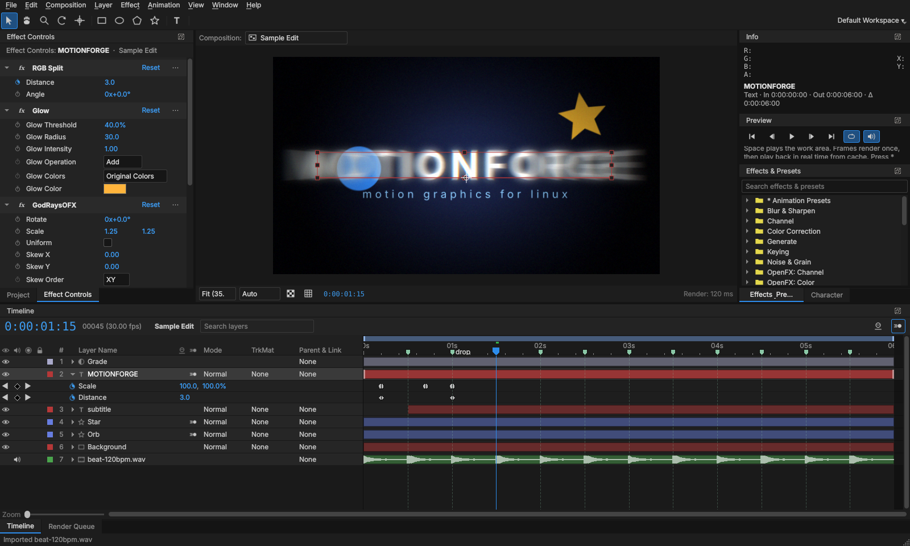

# MotionForge

**Motion graphics and compositing for Linux, with an After Effects-style workflow.**

MotionForge is a native C++/Qt6 application written from scratch. It is laid out and behaves
like After Effects (panels, timeline, switches, keyframes, expressions, shortcuts), so AE users
can make edits without relearning everything. It is an independent project and is **not**
affiliated with, derived from, or endorsed by Adobe. It does not use any Adobe code.


## What works today (milestones 1–3)

**Workspace**
- AE-style dockable panels: Project, Composition viewer, Timeline, Effect Controls,
  Effects & Presets, Character, Info, Preview, Render Queue. Layout is saved, and
  *Window ▸ Reset Workspace* restores the default.
- Dark theme, AE-style blue scrubbable values, label colors, and the familiar menu structure
  (File, Edit, Composition, Layer, Effect, Animation, View, Window, Help).
- Tools: Selection (V), Hand (H), Zoom (Z), Rotation (W), Pan Behind (Y),
  Rectangle/Ellipse/Polygon/Star (Q), Type (Ctrl+T).

**Compositions & layers**
- Compositions with presets (1080p, 4K, vertical 1080×1920 for TikTok/Reels/Shorts, square…),
  frame rates from 8 to 120 fps, background color, and work area.
- Layer types: footage (video and images), solids, text, shapes, nulls, adjustment layers, precomps.
- Transform: anchor point, position, scale, rotation, opacity, and parenting (Parent & Link).
- Switches: video, solo, lock, shy, motion blur. Blending modes: Normal, Add, Multiply, Screen,
  Overlay, Darken, Lighten, Color Dodge, Color Burn, Hard Light, Soft Light, Difference, Exclusion.
- Track mattes: Alpha, Alpha Inverted, Luma, Luma Inverted.
- Motion blur: per-layer switch plus the composition master switch, with shutter angle and sample count.
- Time remapping, time stretch, split layer, trim, pre-compose, duplicate, copy/paste.

**Animation**
- Stopwatch keyframing on every property: linear, Easy Ease (F9 / Shift+F9 / Ctrl+Shift+F9) and hold.
- Keyframe navigator, marquee selection, dragging keys, copy/paste keys.
- Motion paths in the viewer, and P/S/R/T/A/U/E property reveal.
- **Expressions** in JavaScript: `wiggle`, `loopOut/loopIn` (cycle, pingpong, offset, continue),
  `linear`, `ease`, `easeIn`, `easeOut`, `random`, `seedRandom`, `noise`, `valueAtTime`, `time`, `value`,
  `thisComp`, `thisLayer`, `index`, and more. Alt+click a stopwatch to add one.
- Animation presets for edits: camera shake, zoom in/out transitions, pop in, fade in/out,
  slide in, bounce, flash, glow pulse, blur in, spin.

**Effects (21 built-in, multi-threaded)**
Gaussian Blur, Fast Box Blur, Directional Blur, Radial Blur (spin/zoom), Sharpen, Glow,
Brightness & Contrast, Hue/Saturation, Tint, Exposure, Levels, Fill, Gradient Ramp, Invert,
Color Key, Drop Shadow, Noise, Vignette, Motion Tile (with mirror edges), RGB Split, Strobe Light.

**Audio & music sync**
- Import music and sound effects (MP3, WAV, AAC/M4A, FLAC, OGG, Opus) or use the audio inside videos.
- Waveforms on timeline layer bars, speaker switch, and keyframeable **Audio Levels** (dB) with `L` to reveal.
- Audio plays during preview and drives the clock, so the picture stays in sync with the music.
- Audio follows layer timing, time stretch, time remapping and nested precomps, and is mixed into exports
  (AAC in MP4, PCM in ProRes MOV, a WAV next to PNG sequences).
- **Composition markers**: press `*` while previewing to tap markers on the beat. Drag markers,
  double-click to name them, and Ctrl+click to delete. J/K jumps between them, and holding Shift
  while dragging layers, keyframes or the time indicator snaps them to markers.

**Plugins (OpenFX)**
- MotionForge is an **OpenFX plugin host**. OpenFX is the open plugin standard used by Natron,
  DaVinci Resolve, Nuke, Vegas and others. Linux OFX plugins show up in the Effect menu and in
  Effects & Presets under *OpenFX: …* categories.
- Plugin parameters are normal MotionForge properties: keyframes, expressions, Effect Controls,
  timeline twirl-downs, copy/paste and project files all work with them. Point parameters are
  draggable layer coordinates, like built-in effects.
- Supported: filter, general and generator plugins; 8-bit and float pixels; render scale (half/quarter
  resolution previews); plugins that grow the frame (glows, shadows); **temporal access**, so time
  effects such as Time Blur, Frame Hold, Retime and Time Offset can read other frames; multithreaded
  plugins.
- **Crash protection:** new plugins are test-loaded in a separate process before MotionForge loads them.
  If a plugin crashes while rendering, MotionForge catches the crash, disables that plugin for the
  session and keeps running, so your project isn't lost.
- Projects remember effects whose plugin isn't installed and keep their settings until it is.
- *Effect ▸ Manage OpenFX Plugins…* shows every plugin found, what loaded and why anything didn't, and
  lets you add plugin folders. `motionforge --ofx-list` prints the same report in a terminal.
- Tested with Natron's free **openfx-misc** collection: 137 of the 148 plugins load and render.
  `./scripts/install-natron-plugins.sh` builds and installs them for you.



**Preview & output**
- Real-time preview: frames render once, then play from a RAM cache (shown as a green bar in the
  timeline ruler). Preview resolution can be Auto, Full, Half, Third or Quarter.
- Render Queue: H.264 MP4, Apple ProRes 422 HQ, ProRes 4444 with alpha, PNG sequence.
- Headless batch rendering, like `aerender`:
  ```
  motionforge --render project.mfproj --comp "Comp 1" --output out.mp4 [--format h264|prores|prores4444|png]
  motionforge --render project.mfproj --frame 2.5 --output still.png
  ```
- Undo/redo for everything, project files (`.mfproj`, JSON), auto-save every 5 minutes.

## Not yet (planned milestones)

| Area | Status |
| --- | --- |
| Graph editor (speed/value curves) | Next milestone |
| OpenFX curve (parametric) parameters, stereo views, Natron multi-plane extensions | Planned (11 openfx-misc plugins need these) |
| On-screen plugin overlays (interacts) and GPU render suites | Planned. Plugins render on the CPU |
| Masks and Pen tool, Bezier shape paths | Planned |
| Per-character text animators | Planned |
| 3D layers, cameras and lights | Planned |
| Motion tracking, Roto Brush-like tools | Planned |
| GPU (OpenGL/Vulkan) rendering | Planned. Rendering is currently multi-threaded CPU |

### About After Effects plugins

Plugins sold for After Effects (`.aex` / `.plugin`, e.g. Red Giant, Video Copilot Element 3D,
Sapphire *for AE*) are closed-source Windows/macOS binaries written against Adobe's private plugin
interface, and most check a license tied to Adobe hosts. Nobody but their vendors can recompile them,
and no Linux application can load them. That includes MotionForge.

What you *can* use on Linux is the **OpenFX** version of a plugin, where the vendor makes one.
Several commercial suites ship Linux OpenFX builds for Resolve and Nuke (for example Boris FX
Sapphire/Continuum and RE:Vision Effects). They are built for the same standard MotionForge hosts,
but they haven't been tested here. Some commercial plugins only license themselves to specific hosts
or require GPU render suites, so try the vendor's trial first. Free collections such as Natron's work
today.

## Build (Ubuntu / Linux Mint / Debian)

Works on Ubuntu 22.04 and newer, Linux Mint 21 and newer, Pop!_OS 22.04+, and Debian 12+.

```bash
git clone -b claude/nice-wright-sz074e https://github.com/kalidatuna/kalidatuna.git ~/motionforge-src
cd ~/motionforge-src/motionforge
./build.sh --deps --plugins   # installs Qt6 + FFmpeg dev packages, builds, runs the tests,
                              # then builds + installs Natron's free OpenFX plugins (~3 min)
./build/motionforge --sample
./build.sh --deb              # optional: build a .deb  →  sudo apt install ./build/motionforge-*.deb
```

If `git clone` says the destination already exists, pick another folder name (the last argument).

Requirements: CMake ≥ 3.21, GCC 11+ (C++20), Qt ≥ 6.2 (Core, Gui, Widgets, Qml, Multimedia),
FFmpeg ≥ 4.4 (libavformat, libavcodec, libavutil, libswscale, libswresample).

## Shortcuts

*Help ▸ Keyboard Shortcuts* (Ctrl+/) lists them all. The most used ones match After Effects:
Space (preview), Ctrl+N (new comp), Ctrl+K (comp settings), Ctrl+Y (solid), Ctrl+Alt+Y (adjustment layer),
Ctrl+D (duplicate), Ctrl+Shift+D (split), Ctrl+Shift+C (pre-compose), Ctrl+M (render queue),
P/S/R/T/A/U/E/L (reveal), J/K (keyframes & markers), `*` (marker), B/N (work area),
[ ] and Alt+[ ] (move/trim to time), F9 (Easy Ease), Ctrl+Alt+T (time remap).

## Project layout

```
src/core     data model: project, compositions, layers, animatable properties, keyframes
src/expr     JavaScript expression engine (QJSEngine)
src/render   CPU compositor, effects, audio mixer, frame cache
src/media    FFmpeg video/audio decoding and encoding
src/ofx      OpenFX plugin host (property/param/image-effect/thread/memory/message suites)
src/ui       the application: panels, viewer, timeline, dialogs
tests        engine tests, GUI smoke tests, and OpenFX test plugins (run with ctest)
third_party  OpenFX SDK headers (BSD-3-Clause)
scripts      helper scripts (e.g. installing Natron's OpenFX plugins)
```

## Troubleshooting plugins

- `motionforge --ofx-list` shows which plugins loaded and why others didn't.
- `MF_OFX_TRACE=1 motionforge` prints every plugin call to the terminal.
- `motionforge --no-plugins` starts without loading any plugins.
- Results of the out-of-process plugin test are cached. They're re-checked automatically when a
  plugin file changes.

## License

Not yet chosen. Until a license is added, all rights are reserved by the author.
