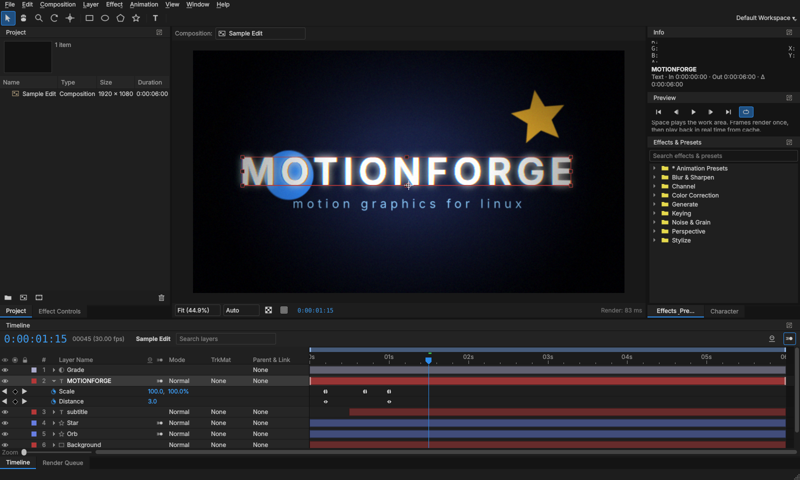

# MotionForge

**Motion graphics and compositing for Linux, with an After Effects-style workflow.**

MotionForge is a native C++/Qt6 application written from scratch. It is laid out and behaves
like After Effects (panels, timeline, switches, keyframes, expressions, shortcuts), so AE users
can make edits without relearning everything. It is an independent project and is **not**
affiliated with, derived from, or endorsed by Adobe. It does not use any Adobe code.



## What works today (milestone 1)

**Workspace**
- AE-style dockable panels: Project, Composition viewer, Timeline, Effect Controls,
  Effects & Presets, Character, Info, Preview, Render Queue. Layout is saved, and
  *Window ▸ Reset Workspace* restores the default.
- Dark theme, AE-style blue scrubbable values, label colors, and the familiar menu structure
  (File, Edit, Composition, Layer, Effect, Animation, View, Window, Help).
- Tools: Selection (V), Hand (H), Zoom (Z), Rotation (W), Pan Behind (Y),
  Rectangle/Ellipse/Polygon/Star (Q), Type (Ctrl+T).

**Compositions & layers**
- Compositions with presets (1080p, 4K, vertical 1080×1920 for TikTok/Reels/Shorts, square…),
  frame rates from 8 to 120 fps, background color, and work area.
- Layer types: footage (video and images), solids, text, shapes, nulls, adjustment layers, precomps.
- Transform: anchor point, position, scale, rotation, opacity, and parenting (Parent & Link).
- Switches: video, solo, lock, shy, motion blur. Blending modes: Normal, Add, Multiply, Screen,
  Overlay, Darken, Lighten, Color Dodge, Color Burn, Hard Light, Soft Light, Difference, Exclusion.
- Track mattes: Alpha, Alpha Inverted, Luma, Luma Inverted.
- Motion blur: per-layer switch plus the composition master switch, with shutter angle and sample count.
- Time remapping, time stretch, split layer, trim, pre-compose, duplicate, copy/paste.

**Animation**
- Stopwatch keyframing on every property: linear, Easy Ease (F9 / Shift+F9 / Ctrl+Shift+F9) and hold.
- Keyframe navigator, marquee selection, dragging keys, copy/paste keys.
- Motion paths in the viewer, and P/S/R/T/A/U/E property reveal.
- **Expressions** in JavaScript: `wiggle`, `loopOut/loopIn` (cycle, pingpong, offset, continue),
  `linear`, `ease`, `easeIn`, `easeOut`, `random`, `seedRandom`, `noise`, `valueAtTime`, `time`, `value`,
  `thisComp`, `thisLayer`, `index`, and more. Alt+click a stopwatch to add one.
- Animation presets for edits: camera shake, zoom in/out transitions, pop in, fade in/out,
  slide in, bounce, flash, glow pulse, blur in, spin.

**Effects (21 built-in, multi-threaded)**
Gaussian Blur, Fast Box Blur, Directional Blur, Radial Blur (spin/zoom), Sharpen, Glow,
Brightness & Contrast, Hue/Saturation, Tint, Exposure, Levels, Fill, Gradient Ramp, Invert,
Color Key, Drop Shadow, Noise, Vignette, Motion Tile (with mirror edges), RGB Split, Strobe Light.

**Preview & output**
- Real-time preview: frames render once, then play from a RAM cache (shown as a green bar in the
  timeline ruler). Preview resolution can be Auto, Full, Half, Third or Quarter.
- Render Queue: H.264 MP4, Apple ProRes 422 HQ, ProRes 4444 with alpha, PNG sequence.
- Headless batch rendering, like `aerender`:
  ```
  motionforge --render project.mfproj --comp "Comp 1" --output out.mp4 [--format h264|prores|prores4444|png]
  motionforge --render project.mfproj --frame 2.5 --output still.png
  ```
- Undo/redo for everything, project files (`.mfproj`, JSON), auto-save every 5 minutes.

## Not yet (planned milestones)

| Area | Status |
| --- | --- |
| Audio (waveforms, playback, export) | Next milestone |
| Graph editor (speed/value curves) | Planned |
| Masks and Pen tool, Bezier shape paths | Planned |
| Per-character text animators | Planned |
| 3D layers, cameras and lights | Planned |
| Motion tracking, Roto Brush-like tools | Planned |
| GPU (OpenGL/Vulkan) rendering | Planned. Rendering is currently multi-threaded CPU |
| **OpenFX plugin host** | Planned: loads OFX plugins built for Linux (e.g. those used by Natron/Resolve) |

### About After Effects plugins

Plugins sold for After Effects (`.aex` / `.plugin`, e.g. Red Giant, Video Copilot, Sapphire for AE)
are compiled Windows/macOS binaries that only run inside Adobe hosts, usually with vendor
licensing checks. No Linux application can load them. MotionForge will instead host
**OpenFX**, the open plugin standard, so Linux builds of plugins (including several commercial
suites that ship OFX versions) can be used.

## Build (Ubuntu / Linux Mint / Debian)

```bash
./build.sh --deps     # installs Qt6 + FFmpeg dev packages with apt, builds, runs tests
./build/motionforge --sample
./build.sh --deb      # optional: build a .deb  →  sudo apt install ./build/motionforge-*.deb
```

Requirements: CMake ≥ 3.21, a C++20 compiler, Qt ≥ 6.4 (Core, Gui, Widgets, Qml),
FFmpeg (libavformat, libavcodec, libavutil, libswscale).

## Shortcuts

*Help ▸ Keyboard Shortcuts* (Ctrl+/) lists them all. The most used ones match After Effects:
Space (preview), Ctrl+N (new comp), Ctrl+K (comp settings), Ctrl+Y (solid), Ctrl+Alt+Y (adjustment layer),
Ctrl+D (duplicate), Ctrl+Shift+D (split), Ctrl+Shift+C (pre-compose), Ctrl+M (render queue),
P/S/R/T/A/U/E (reveal), J/K (keyframes), B/N (work area), [ ] and Alt+[ ] (move/trim to time),
F9 (Easy Ease), Ctrl+Alt+T (time remap).

## Project layout

```
src/core     data model: project, compositions, layers, animatable properties, keyframes
src/expr     JavaScript expression engine (QJSEngine)
src/render   CPU compositor, effects, frame cache
src/media    FFmpeg decoding and encoding
src/ui       the application: panels, viewer, timeline, dialogs
tests        engine tests and GUI smoke tests (run with ctest)
```

## License

Not yet chosen. Until a license is added, all rights are reserved by the author.
