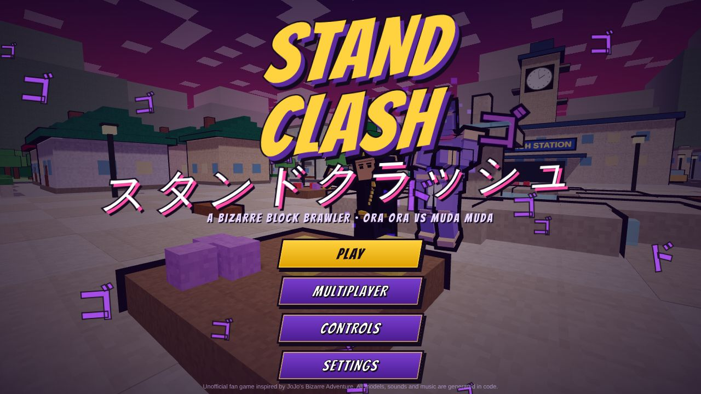
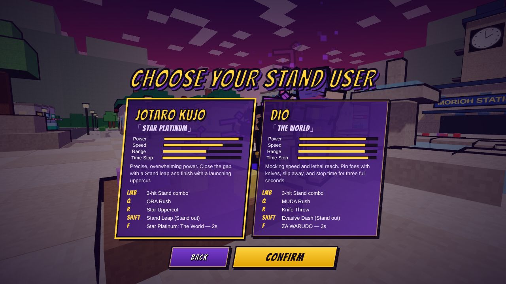
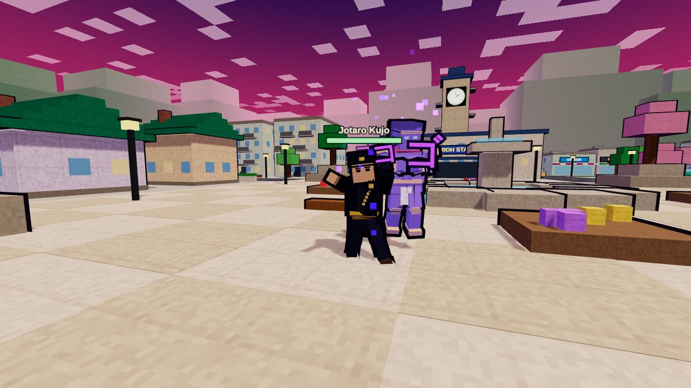
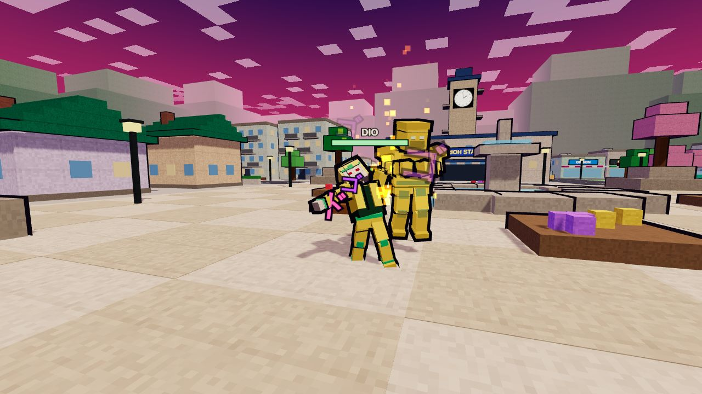
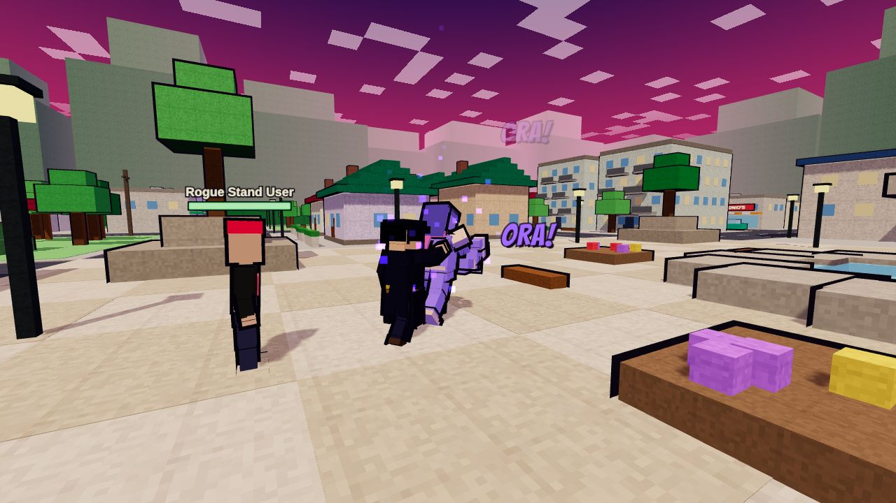
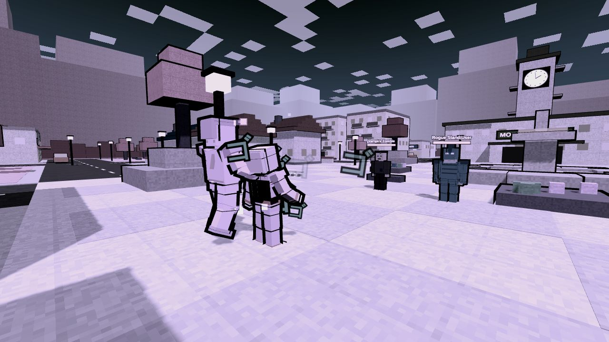
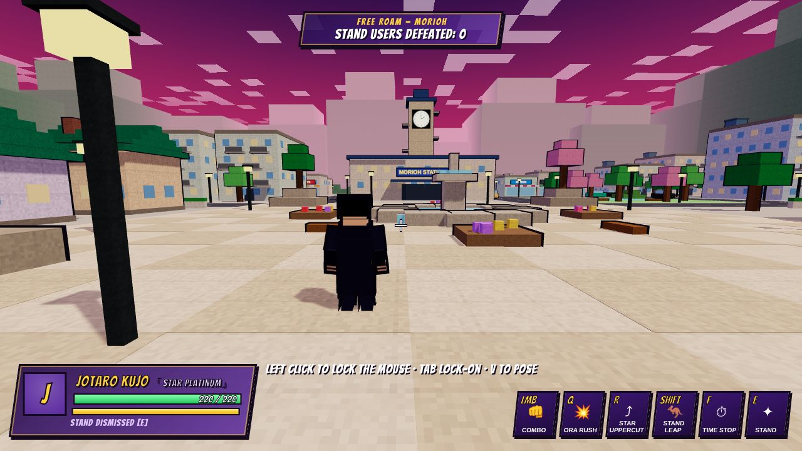
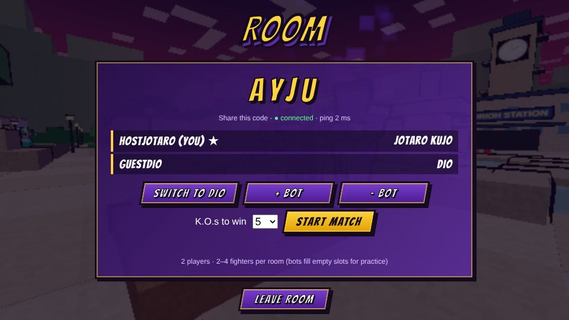

# STAND CLASH

A fast third-person, blocky (voxel-style) Stand battle game for the browser. It's an unofficial fan project inspired by *JoJo's Bizarre Adventure*. You explore a Morioh-inspired town, chain Stand combos, stop time, complete missions, and duel friends online.

- **Client:** Three.js + TypeScript + Vite
- **Server:** Node.js + `ws`. It serves the built client and runs authoritative multiplayer rooms.
- **Assets:** none. Every model, texture, sign, sound effect and music loop is generated in code, so the project runs right after `npm install`.

| | |
| --- | --- |
|  |  |
|  |  |
|  |  |
|  |  |

## Quick start

Requires **Node.js 20+** (tested on Node 22).

```bash
cd stand-clash
npm install

# Option A – one command, production build served by the game server
npm run build
npm start
# open http://localhost:8080

# Option B – development (hot reload): Vite on :5173 + game server on :8080
npm run dev
# open http://localhost:5173   (the /ws WebSocket is proxied to :8080)
```

Click the game to capture the mouse. Press **Esc** to pause and release it.

## Controls

| Input | Action |
| --- | --- |
| **W A S D** | Move (camera-relative, with acceleration) |
| **Mouse** | Camera and aim (pointer lock) |
| **Space** | Jump. Press again in the air to double jump. With your Stand out, the air jump becomes a big **Stand-assisted leap** (about 7 m total) that reaches rooftops. While airborne you automatically mantle ledges up to 1.2 m above your feet. |
| **Shift** | Dash or air dash. With your Stand out it becomes your special move: **Star Platinum Leap** (Jotaro) or **Evasive Dash** with i-frames (DIO). |
| **E** | Summon or dismiss your Stand |
| **Left click** | 3-hit basic combo. Your Stand punches when summoned. |
| **Right click** | Block (hold). Start a block just before a hit to get a **PERFECT BLOCK**. |
| **Q** | Barrage (ORA ORA / MUDA MUDA) |
| **R** | Jotaro: **Star Uppercut** (launches, breaks guard). DIO: **Knife Throw** (aims with the crosshair). |
| **F** | Time stop: Jotaro 2 s, DIO 3 s, 38 m radius, long cooldown |
| **V** | JoJo pose (triples Stand-energy regen, spawns ゴゴゴゴ) |
| **Tab / middle click** | Lock on to the nearest enemy |
| **Esc** | Pause menu (controls, settings, restart, quit) |

## Characters

| | Jotaro Kujo「Star Platinum」 | DIO「The World」 |
| --- | --- | --- |
| LMB | 3-hit Stand combo (6 / 6 / 11, finisher knocks back) | same frame data |
| Q | ORA Rush: ~17 hits + launcher, pulls the target in | MUDA Rush: slightly faster, shorter |
| R | Star Uppercut: 17 dmg, launches, breaks guard | Knife Throw: fan of 5 aimed projectiles |
| Shift (Stand out) | Stand Leap: arcing gap-closer with landing shockwave | Evasive Dash: 36 m/s burst with i-frames |
| F | Star Platinum: The World, **2 s** | ZA WARUDO, **3 s** |

Every attack has real hit detection: a hit sphere at a set reach against the target's body capsule. Attacks also have range limits, damage, hit-stun, knockback, recovery windows, cooldowns and Stand-energy costs. All of these values are defined in `src/shared/characters.ts`.

**Time stop.** After a short wind-up, every fighter and projectile within 38 m freezes, along with their AI, physics and animation. The caster can still move and attack. Hits on frozen targets are queued, shown as faded numbers, and land all at once when time resumes. Knives DIO throws during stopped time fly a short distance and then hang in the air. The camera, HUD and menus stay responsive, and the screen inverts and then desaturates while time is stopped.

## Modes

- **Free Roam:** explore the town (streets, alleys, shops, apartments with climbable balconies, a park, the station clock tower, and the central fountain plaza) and fight enemies that keep respawning: Vampire Zombies, Rogue Stand Users with the red Stand "Red Riot", and Hol Horse with Emperor.
- **Training:** a configurable dummy. Behaviours are stand still, always block, perfect blocker, jump, and fight back. You can toggle immortality and no-cooldown/infinite-energy, and the panel shows last-hit, combo, max-combo and DPS readouts.
- **Missions:**
  1. *Morioh Menace:* defeat 6 Stand users.
  2. *Night of the Vampires:* survive 3 waves.
  3. *DIO's World:* a boss fight against DIO (3.6× HP, uses time stop, gets serious at 50%). If you play as DIO, you face Shadow DIO.

  Results screens give a rank. You can **Retry** or go to the **Next Mission**.
- **Multiplayer:** host a room, share its 4-letter code, and play free-for-all with 2–4 fighters (bots can fill slots). First to 3/5/10 K.O.s, or the leader after 4 minutes, wins.

## Multiplayer architecture

- **Movement is client-predicted.** Each client simulates its own fighter locally, so movement stays crisp, and sends its state 30×/s. The server sanity-checks the speed (it corrects teleports) and ignores movement from frozen or dead players.
- **Combat is server-authoritative.** Clients only send ability *requests* (`act`). The server runs the same shared simulation (`src/shared/sim.ts`) at 60 Hz. It checks cooldowns, energy, stun and time-stop state, then resolves hits, blocks, perfect blocks, damage, knockback, projectiles, time stop and its queued damage, K.O.s and respawns. Bots also run on the server.
- **The server pushes snapshots and events.** It sends snapshots at 20 Hz and gameplay events as soon as they happen. Clients interpolate the other fighters 100 ms in the past, and apply knockback and stun events to their own fighter.

### Hosting for friends over the internet

The server listens on `0.0.0.0:8080` by default. You can change this with `PORT=xxxx` and `HOST=…`.

1. **Same Wi-Fi / LAN:** run `npm run build && npm start`. Friends open `http://<your-LAN-IP>:8080`.
2. **Over the internet (port forwarding):** forward TCP port 8080 on your router to your machine. Friends open `http://<your-public-IP>:8080`.
3. **Without port forwarding (tunnel):** run the server, then expose it with a tunnel, for example `cloudflared tunnel --url http://localhost:8080` or `ngrok http 8080`. Share the `https://…` URL; the client automatically uses `wss://…/ws`.
4. **On a VPS / PaaS (Render, Railway, Fly.io, a small VM):** use the build command `npm install && npm run build` and the start command `npm start`. The server honours `$PORT`, and `GET /health` returns room and client counts.

In the multiplayer screen the **Server** field defaults to the page's own host (`ws(s)://<host>/ws`). If the page comes from somewhere else, for example the Vite dev server, enter a different WebSocket URL there.

## Project layout

```
stand-clash/
  index.html                 page shell
  server/server.ts           HTTP static server + WebSocket rooms (authoritative sim, bots)
  src/shared/                runs in browser AND server
    math.ts                  vectors, angles, seeded RNG
    world.ts                 deterministic Morioh town layout, spatial grid, raycasts, swept AABB physics
    characters.ts            characters, abilities, hit/frame data, movement tuning
    sim.ts                   fighters, input → actions, combat, blocking, combos, projectiles, time stop, KO/respawn
    ai.ts                    bot brains (melee, ranged, boss, training-dummy behaviours)
    protocol.ts              network message types
  src/client/
    main.ts                  bootstrap
    game/game.ts             renderer, loop, hit-pause, events → effects/audio/HUD
    game/modes.ts            Free Roam, Training, Missions
    game/mp.ts               multiplayer client (prediction + interpolation)
    engine/                  input, camera rig, synthesized audio, settings
    render/                  instanced town, articulated character/Stand models, animation, effects
    ui/                      HUD, menus, styles
  tests/
    sim.test.ts              headless simulation tests (npm run test:sim)
    smoke.mjs / gameplay.mjs / multiplayer.mjs   browser end-to-end checks (Playwright)
```

## Performance notes

- The whole town (about 4,000 boxes) is drawn with one `InstancedMesh` per material, plus one instanced outline mesh. That's roughly 15 draw calls.
- Each character joint is a single merged, vertex-coloured mesh. Outlines use the inverted-hull method and share one material.
- Geometry is cached per character type. Barrage fists and knives are instanced.
- Particles use two `Points` buffers. Rings, starbursts, trails, menacing glyphs and damage numbers come from preallocated pools, so combat allocates nothing per hit.
- The shadow camera follows the player. Shadows and pixel ratio can be adjusted (Settings → Shadows).

## Testing

```bash
npm run typecheck            # TypeScript, client + server
npm run test:sim             # 43 headless sim checks: movement, collisions, rooftops, every ability, time stop, blocks, KO, AI, boss

# browser + protocol tests need the server running with a fresh build
npm run build && npm start &
npm run test:server          # 2 raw WebSocket clients: rooms, anti-teleport, server cooldowns, full match to 3 K.O.s
npm run test:e2e             # drives the real game in headless Chromium (43 checks)
npm run test:mp              # two browser sessions in one room + a bot room (23 checks)
npm run screenshots          # full-quality gallery into tests/out/
```

The browser tests use Playwright. Run `npx playwright install chromium` once if you have no Chromium. They load the page with `?test&lowgfx`. `test` lets clicks register without pointer lock, and `lowgfx` uses a lower resolution so software WebGL keeps up.

See **[TESTING.md](TESTING.md)** for what was verified and what wasn't.

---
*Unofficial, non-commercial fan work. JoJo's Bizarre Adventure and its characters belong to Hirohiko Araki / Shueisha. No original assets are used: everything is generated procedurally.*
