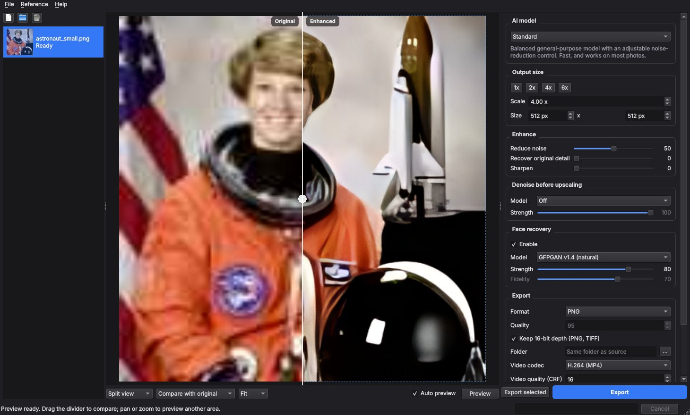

# AI Enhancer

An open-source desktop app for AI photo and video enhancement: upscaling, noise reduction, and face recovery. It covers the same jobs as Topaz Gigapixel, Photo AI, and Video AI, using openly published models. It also includes a tool that measures how close its output is to a Topaz export and finds the settings that match it best.



> **How this relates to Topaz.** This project contains no Topaz code, models, or files, and it does not modify or unlock Topaz software. Topaz's models are proprietary, so pixel-identical output is not possible. Instead, this app uses open models that do the same kinds of work. The `match` tool compares results against a Topaz export of the same image to find the closest settings.

## Features

| Topaz feature | Here | Open model behind it |
| --- | --- | --- |
| Gigapixel "Standard" with noise and blur controls | **Standard** model with a *Reduce noise* slider | Real-ESRGAN general v3. The slider interpolates the weights of the sharp and denoising variants. |
| Gigapixel "High Fidelity" | **High Fidelity** | SwinIR-L (real-world SR, GAN) |
| Gigapixel "Low Resolution" / "Recovery" | **Low Resolution / Heavy Recovery** | Real-ESRGAN x4plus |
| Gigapixel "Art & CG" | **Art & CG** | Real-ESRGAN x4plus anime 6B |
| Photo AI Denoise (Normal / Strong) | **Denoise before upscaling** | SCUNet (PSNR and GAN variants) |
| Face Recovery | **Face recovery** with strength (and fidelity for CodeFormer) | YuNet detector, then GFPGAN v1.4 or CodeFormer |
| "Recover original detail" | **Recover original detail** slider | Blends the Lanczos-resized original back in |
| Sharpen | **Sharpen** slider | Unsharp mask (not an AI deblur model) |
| Video AI upscaling | Video files in the same queue | Per-frame processing through FFmpeg; audio is kept |

App features:

- A queue for images, folders, and videos, with drag and drop.
- A before/after viewer with split, side-by-side, before-only and after-only modes, wheel zoom, and drag to pan.
- **Live preview** of the visible area. It reruns automatically when settings change. Detail, sharpen, and face settings reuse the cached AI result, so they update almost instantly.
- **Reference comparison.** Load a Topaz export of the same image, compare it side by side, score it, and run *Match settings to reference*.
- Any output scale from 0.25x to 16x, or an exact size in pixels. Above the model's native scale, it runs a second AI pass.
- Keeps 16-bit depth, alpha channels, EXIF orientation, ICC profiles, and EXIF metadata.
- Tiled processing with blended seams, so large images fit in limited GPU or CPU memory.
- Runs on NVIDIA CUDA, Apple Metal (MPS), or CPU. Half precision is used on CUDA where the model supports it.
- Saves and loads presets as JSON. The GUI and CLI share the same format.

## Install

Requires Python 3.10 or later. FFmpeg is only needed for video.

```bash
cd tools/ai-enhancer
python -m venv .venv
source .venv/bin/activate          # Windows: .venv\Scripts\activate
# NVIDIA GPU: install the CUDA build of PyTorch first, from https://pytorch.org/get-started/locally/
pip install -e .
```

Models download automatically on first use, from each project's official release page. Each download is checked against a pinned SHA-256 hash. Files are stored in `~/.cache/ai-enhancer/models` (Windows: `%LOCALAPPDATA%\ai-enhancer\models`); set `ENHANCER_MODEL_DIR` to use a different folder. To download everything in advance (about 1.2 GB):

```bash
ai-enhancer models --download all
```

## Use the app

```bash
ai-enhancer            # or: ai-enhancer-gui, or: python -m enhancer
```

1. Drop images or videos onto the window, or use **Add files** or **Add folder**.
2. Pick an **AI model** and an **output size**. The preview updates for the area you are looking at; zoom in and pan to check other areas.
3. Adjust *Reduce noise*, *Recover original detail*, *Sharpen*, and *Face recovery*. Drag the white divider to compare.
4. Choose the format and folder under **Export**, then click **Export** (all files) or **Export selected**.

## Command line

```bash
# Upscale 4x with face recovery
ai-enhancer enhance photo.jpg --scale 4 --face gfpgan -o out/

# A whole folder to an exact width, as 16-bit TIFF
ai-enhancer enhance scans/ --model high-fidelity --width 6000 --format tiff -o out/

# Denoise first, then upscale 2x with some original detail kept
ai-enhancer enhance noisy.png --denoise strong --model standard-2x --scale 2 --recover 0.2

# Video: 2x upscale to H.265, audio kept
ai-enhancer enhance clip.mp4 --scale 2 --codec h265 --crf 18 -o out/

# Use a saved preset, overriding one value
ai-enhancer enhance photo.jpg --preset best.json --sharpen 0.1
```

Run `ai-enhancer enhance --help` to see every option.

## Matching Topaz output

The models differ, so matching works by measurement:

1. Export one representative image from Topaz, for example at 4x.
2. Run the search on the original and the Topaz export:

   ```bash
   ai-enhancer match original.jpg original-topaz-4x.jpg --save-preset topaz-like.json
   ```

   This tries every model and noise level on a region of the image (the largest face, if there is one). It then fine-tunes detail, sharpening, and face strength. Results are ranked by SSIM, PSNR, and colour difference against the Topaz export.
3. Process your other images with that preset: `ai-enhancer enhance photos/ --preset topaz-like.json`.

In the GUI, the same steps are under **Reference → Load reference image** and **Reference → Match settings to reference**. Setting *Compare with reference* puts the Topaz export on the left of the divider.

To score any two images directly:

```bash
ai-enhancer compare ours.png topaz.png --diff difference.png
```

In testing, `match` recovered hidden settings exactly: model, *Recover* 0.2 and *Sharpen* 0.3, from a reference made with this tool. Against a real Topaz export, expect a close match, not an identical one.

## Speed

Measured on a 4-core CPU with no GPU, upscaling a 128x128 image to 512x512:

| Setting | Time |
| --- | --- |
| Standard | 1.2 s |
| Low Resolution | 3.1 s |
| Standard + GFPGAN | 4.0 s |
| Standard + CodeFormer | 3.8 s |

Time grows with output pixel count. High Fidelity (SwinIR-L) is several times slower than the others. Use a CUDA or Apple GPU for large photos and video. If you run out of GPU memory, lower the **Tile size** under *Performance*.

## Limitations

- Results are close to Topaz but not identical: the models are different.
- Video is processed frame by frame. GAN models can flicker slightly between frames, and there is no temporal model or frame interpolation (slow motion / FPS conversion) yet.
- Sharpening is a classic unsharp mask, not an AI motion or lens-blur model.
- Face recovery works on faces the detector finds (frontal or near-frontal, roughly 20 px wide or larger in the source).

## Models and licenses

The code in this folder is MIT-licensed. Each model has its own license:

| Model | Source | License |
| --- | --- | --- |
| Real-ESRGAN (general v3, x4plus, x2plus, anime 6B) | [xinntao/Real-ESRGAN](https://github.com/xinntao/Real-ESRGAN) | BSD-3-Clause |
| SwinIR-L real-world SR | [JingyunLiang/SwinIR](https://github.com/JingyunLiang/SwinIR) | Apache-2.0 |
| SCUNet | [cszn/SCUNet](https://github.com/cszn/SCUNet) | Apache-2.0 |
| GFPGAN v1.4 | [TencentARC/GFPGAN](https://github.com/TencentARC/GFPGAN) | Apache-2.0 |
| CodeFormer | [sczhou/CodeFormer](https://github.com/sczhou/CodeFormer) | S-Lab License 1.0, **non-commercial use only** |
| YuNet face detector | [opencv/opencv_zoo](https://github.com/opencv/opencv_zoo) | MIT |

Models are loaded with [spandrel](https://github.com/chaiNNer-org/spandrel). If you use this commercially, choose GFPGAN rather than CodeFormer.

## Development

```bash
pip install -e ".[dev]"
pytest              # 26 tests, offline; a fake model stands in for real checkpoints
pyflakes enhancer tests
```

GUI tests run headless (`QT_QPA_PLATFORM=offscreen`). On a minimal Linux system they need `libegl1`, and they are skipped if Qt cannot start.

| Module | Role |
| --- | --- |
| `enhancer/models.py` | Model registry, verified downloads, loading, weight interpolation |
| `enhancer/tiling.py` | Tiled inference with blended seams |
| `enhancer/pipeline.py` | Denoise, upscale, recover detail, faces, sharpen; cached region preview |
| `enhancer/faces.py` | Face detection, FFHQ alignment, restoration, feathered paste-back |
| `enhancer/video.py` | FFmpeg decode and encode pipes, audio passthrough |
| `enhancer/compare.py` | SSIM, PSNR, ΔE, and the settings search |
| `enhancer/gui/` | PySide6 app: main window, viewer, settings panel, background jobs |
